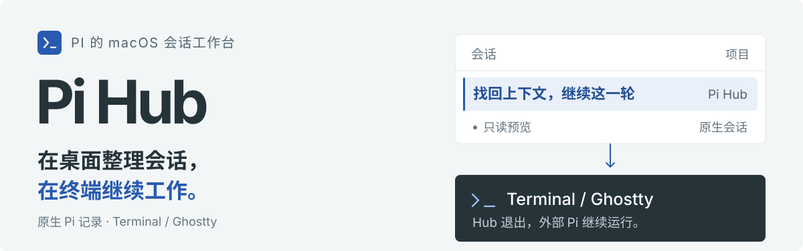
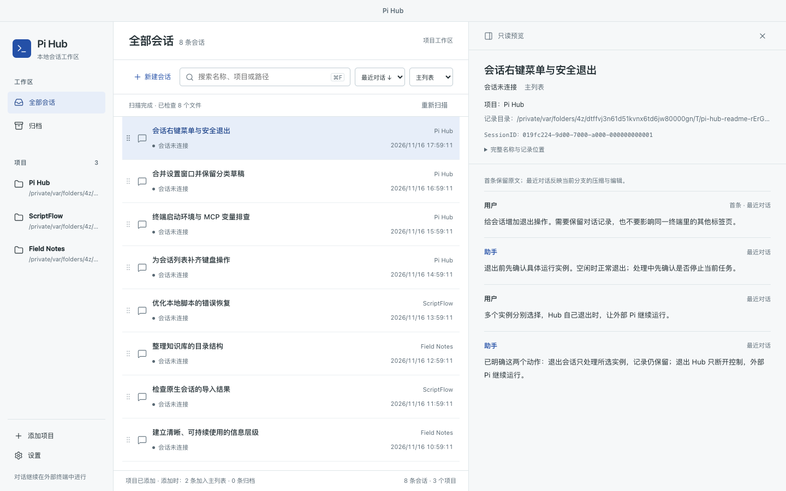
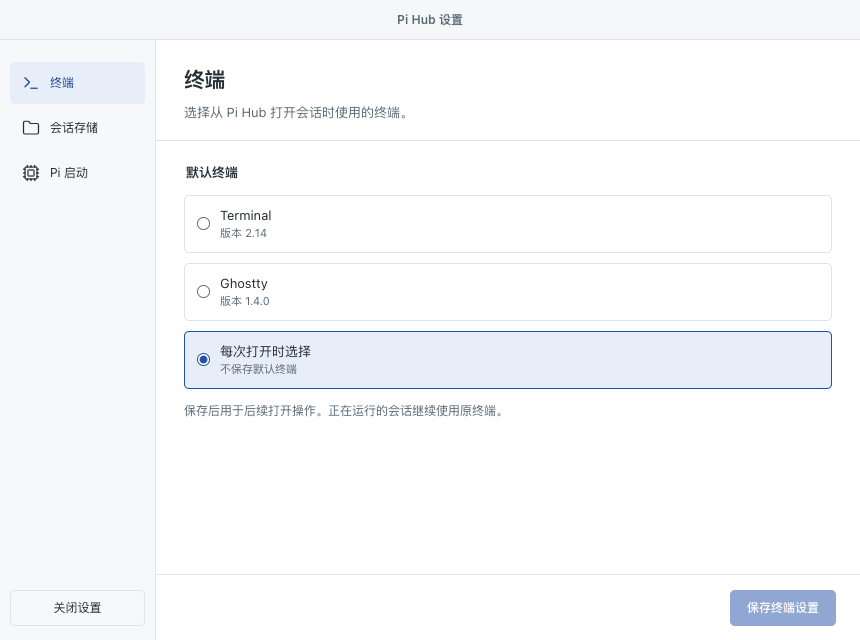

<p align="center">
  <picture>
    <source media="(max-width: 600px)" srcset="assets/readme/hero-compact.svg">
    
  </picture>
</p>

**Pi Hub 是 [Pi](https://github.com/earendil-works/pi) 的 macOS 会话工作台。** 按项目找到历史、预览上下文、整理会话，再回到熟悉的终端继续。名称、分支和对话仍保存在原生 Pi 记录中。

[快速开始](#快速开始) · [文档](docs/README.md)

<a href="assets/readme/workspace-light.png">
  <picture>
    <source media="(prefers-color-scheme: dark)" srcset="assets/readme/workspace-dark.png">
    
  </picture>
</a>

<sub>真实应用截图，使用合成演示会话；点击查看大图。支持浅色、深色与窄窗口。</sub>

## 找到会话，也找回上下文

- **按项目收拢历史** — 发现标准目录或自定义位置的 Pi 会话，选择需要管理的历史；按名称、项目、路径搜索。
- **先读，再继续** — 只读预览当前分支的首条用户消息与最近三轮对话，双击会话直接在外部终端打开。
- **管理操作就在条目旁** — 原生右键菜单提供重命名、复制并切换、归档、完整 ID 复制、访达定位和退出可控实例。拖动或 Option + ↑ / ↓ 调整当前页顺序。
- **设置集中，工作不断** — 独立设置窗口管理默认终端、会话存储与 Pi 启动配置；切换类目保留草稿。

<details>
<summary>查看独立设置窗口</summary>
<br>

</details>

## 从桌面整理到终端继续

<picture>
  <source media="(max-width: 600px)" srcset="assets/readme/workflow-compact.svg">
  
</picture>

Pi Hub 管理项目和分类，Pi 管理对话与分支。导入与归档不会搬迁原文件；重命名对应 `/name`，允许清空；“复制并切换…”遵循原生 `/clone`，在同一运行实例切到副本。

**退出 Hub，外部 Pi 继续运行。** 需要停止某个实例时，从该会话的右键菜单选择退出；处理中会先确认，原会话记录保留。

## 快速开始

需要 **macOS、Node.js 24+ 和 Pi**；终端使用 Terminal 或 Ghostty。当前包内 SDK 与宿主验证版本为 **Pi 1.5.2**。

```sh
npm ci
npm start
```

1. 点击「添加项目」，选择工作目录及要纳入主列表的历史会话。
2. 搜索并单击会话，读取预览；双击继续原会话。
3. 首次打开时选择终端，可勾选记为默认；以后在左下角「设置」或 `⌘ ,` 修改。

Hub 默认数据位于 `~/.pi-hub`；原生会话默认读取 `~/.pi/agent/sessions`，其他位置在「设置 → 会话存储」添加。Pi 与 Node 路径自动检测，启动排障与权限说明见[本机应用文档](docs/local-app.md)。

## 开发与文档

```sh
npm run typecheck
npm test               # 服务层测试
```

桌面与真实终端检查需要显式的应用路径和自有测试目录，按[测试规则](docs/testing.md)执行。

| 想了解 | 从这里开始 |
| --- | --- |
| 产品行为与边界 | [产品规格](docs/product-spec.md) |
| 构建、使用与排障 | [本机应用](docs/local-app.md) |
| 原生 Pi 集成与架构 | [集成事实](docs/pi-integration-facts.md) · [架构决策](docs/README.md#架构决策) |
| 界面与交互规范 | [清爽秩序设计](DESIGN.md) |
| 测试与协作 | [测试规则](docs/testing.md) · [开发约定](AGENTS.md) |

更多内容见[文档入口](docs/README.md)。
